# DynCLM Final Report

Generated: 2026-10-13 · Live oMLX `Qwen3.8-27B-4bit` · Apple M5 Max (128GB; oMLX ~8 GB in-memory cache)

Companions: [method.md](method.md) · [decision-report.md](decision-report.md) · [verification.md](verification.md)

## What we are trying to achieve

**Premise.** CLM soft-marks stale spans and physically rewrites **every turn** that has dead text - selective verbatim reclaim, but constant rewrite/re-prefill cost. **DynCLM** uses that **same** mark → drop → survivors-as-new-context methodology, but keeps marks soft until a cost model says we are tight on budget/memory, then runs one batched rewrite. Where per-turn rewrite is expensive, DynCLM should cut rewrite load versus CLM while matching CLM on quality canaries that need selective ignore. Method + session-load math: **[method.md](method.md)**.

**Mac / bandwidth.** A competing view is that CLM is unsuitable for Mac because always-rewrite/re-prefill hits **memory-bandwidth** limits on unified memory. This report is the M5 Max side of that comparison: either CLM is viable here, or DynCLM’s per-device calibration (`ρ`) is the lever for SKUs that do suffer (hypothesized: **M5 Pro**, base **M5**). Full framing: [method.md § Hardware framing](method.md#hardware-framing-mac--apple-silicon).

This report is the **live proof attempt** of that premise on oMLX / **Apple M5 Max** (plus quality vs raw append-only and vs Codex-style summarize compact):

1. Does DynCLM **work** (markers, rewrites, shrink) and stay cheaper on rewrite prefill than always-rewrite CLM?
2. Does it **keep late-session answers correct** when raw append-only or summarize+recency baselines fail FACT/SPEC canaries?
3. Does it **shrink context** (and sometimes wall-clock) enough to be worth the reclaim prefill vs a never-rewrite baseline?
4. On this Mac SKU, is **always-rewrite CLM** still usable - or do we need DynCLM’s **hardware profile** so narrower-bandwidth chips can defer?

We are **not** reproducing the CLM paper’s TerminalBench / BrowseComp / EdgeBench numbers, and SWE-Distill here is a Lite-inspired reclaim harness, not official SWE-Bench resolve rate.

## Iterations (how we got here)

Early work used a 900-cell policy grid (paused), then an efficient 3-arm decision suite (gate / graded quality / long-horizon A, plus an LH-B matrix under blind FIFO drop-oldest). We then changed the compact baseline to **Codex-style rolling summary** and re-ran long-horizon B and the SWE-Distill baseline under that protocol. Marker-arm SWE cells that already matched the final reclaim path were kept. **Everything below is the final methodology and numbers only**; superseded FIFO LH-B figures are not cited.

| Final evidence | Run |
|---|---|
| Gate, graded quality, long-horizon A | `20261010T145959Z_decision` |
| Long-horizon B (summarize compact) | `20261013T201630Z_lh_compaction_summary` |
| SWE-Distill | `20261013T190132Z_swe_distill_summary_baseline` (DynCLM/CLM cells from `20261010T225155Z_swe_distill`) |

---

## How to read

| Label | Meaning | Suites |
|---|---|---|
| **Baseline (raw)** | Append-only; no markers; no rewrite; no compaction | Gate, graded quality, long-horizon A |
| **Baseline + compaction** | Codex-style rolling summary over `max_context` (keep system + recent raw; fold older spans into `[CONTEXT_SUMMARY]`; re-prefill) | Long-horizon B, SWE-Distill |
| **DynCLM** | Soft-invalidation markers + cost-model deferred rewrite | All |
| **CLM (immediate rewrite)** | Soft-invalidation markers + rewrite every turn | All |

Compare each suite only to **its** reference baseline (raw or summarize-compact).

**Serving.** oMLX has no span-level KV API. Prefill uses `LogicalCacheBackend` (span cap K=6) - logical SCR-shaped accounting, not physical relocation. Long-horizon and SWE-Distill marker arms serve prompts via `ContextTextForServing` (dead bodies stubbed).

---

## Executive summary

| Suite | Ref. baseline | Headline |
|---|---|---|
| Short live gate (8×40) | Raw | **PASS** G1–G4. DynCLM avg ctx **−53.8%**, session wall **−9.0%**; rewrite prefill **−71.1%** vs CLM |
| Graded quality (18 tasks) | Raw (short; no window reclaim) | **94.4% → 100%** (+5.6 pp). Flat ~162-token context |
| Long-horizon A (3×24) | Raw + recency | Late FACT probe **0% → 100%**. DynCLM late ctx **−70.8%**; CLM fastest late wall |
| Long-horizon B (2×20 @ 16k/64k) | Summarize + recency | Late FACT probe **0% → 100%** (baseline answers `WRONG_*`). DynCLM late wall beats compact baseline |
| SWE-Distill (6 tasks) | Summarize + recency | Final probe **50% → 100%** (+50 pp); **`spec_survive` 100%** on all arms |

**Bottom line.** DynCLM matches CLM on these quality canaries while rewriting far less often than always-rewrite CLM. Under summarize compaction, SWE retains the early SPEC (`spec_survive` 100%) but DynCLM/CLM still win by **+50 pp** via soft-invalidation vs recency confusion. Long-horizon B is the harder FACT canary (baseline late probe 0%).

**Ship:** **yes**, for this local stack - with tradeoffs: reclaim prefill vs raw baseline; often slower than CLM on late wall; canaries are not TerminalBench / official SWE-Bench / paper FLOP claims.

---

## Figures

Regenerate with `make charts`.

### Long-horizon A (vs raw)

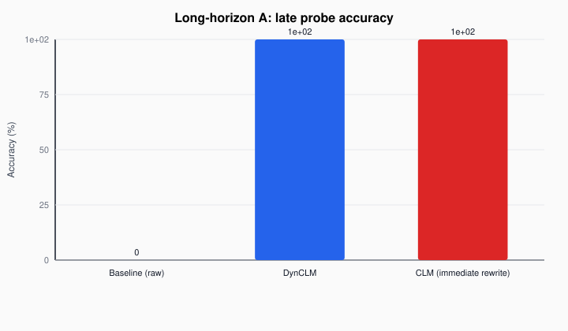

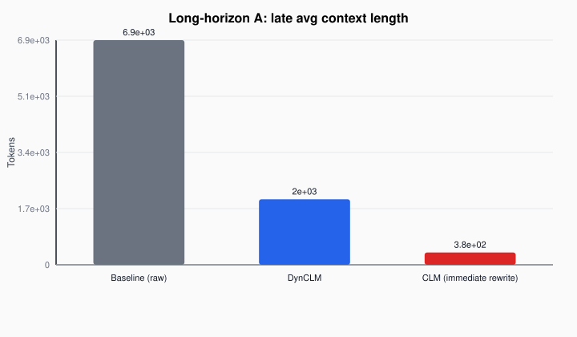

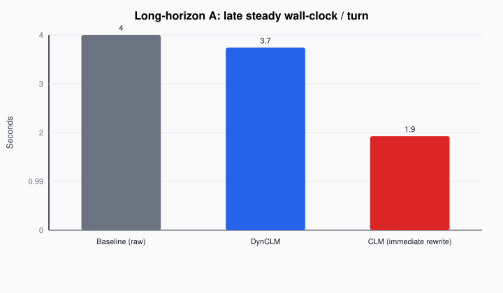

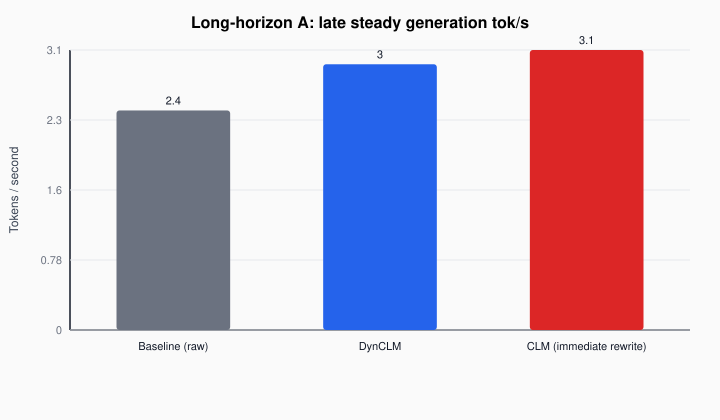

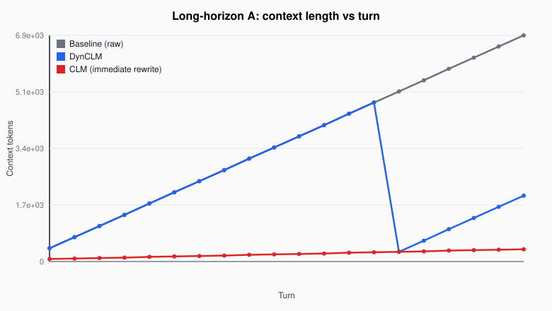

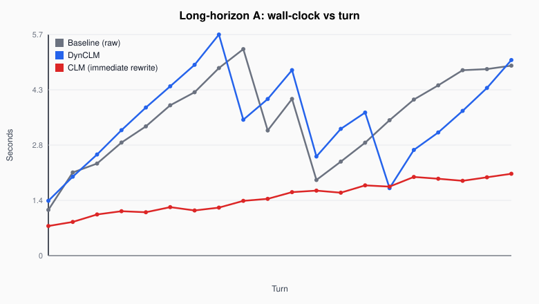

### Short suites

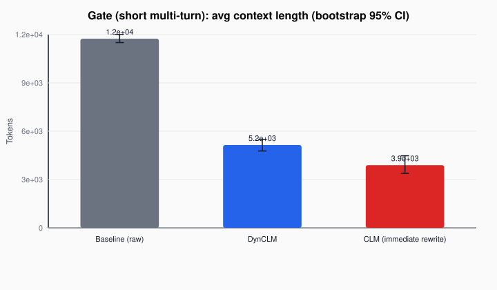

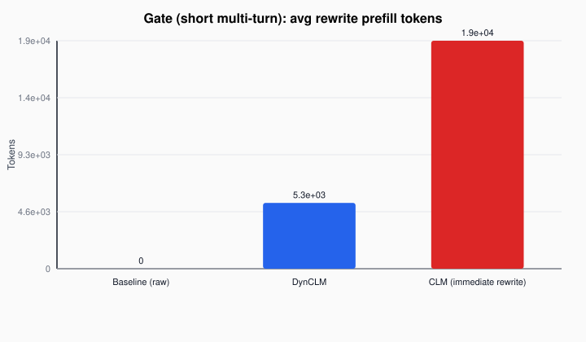

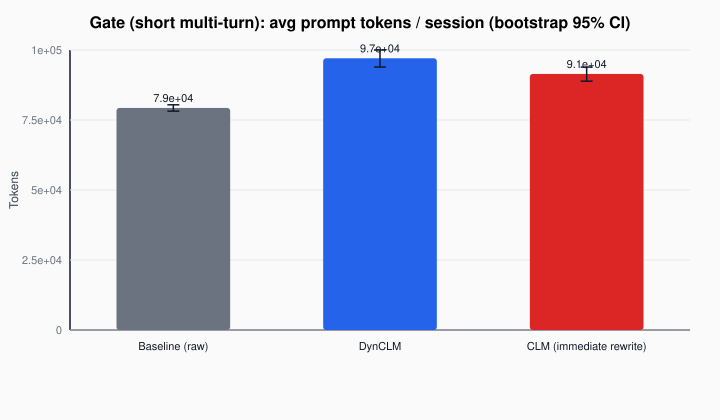

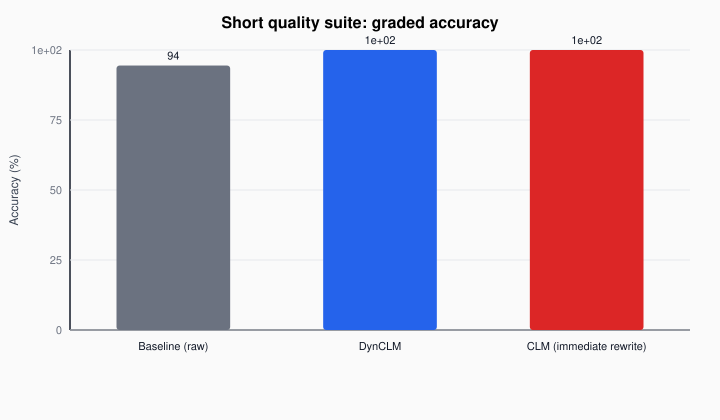

### Long-horizon B (summarize matrix)

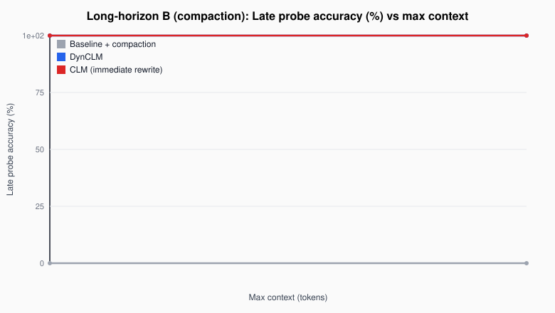

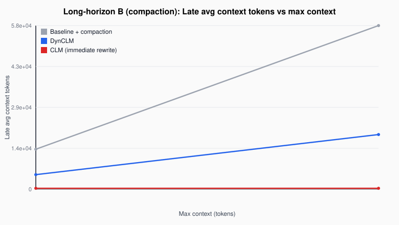

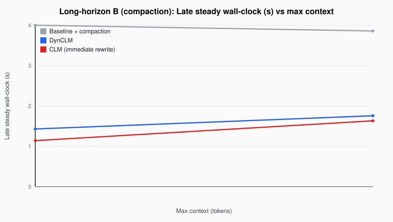

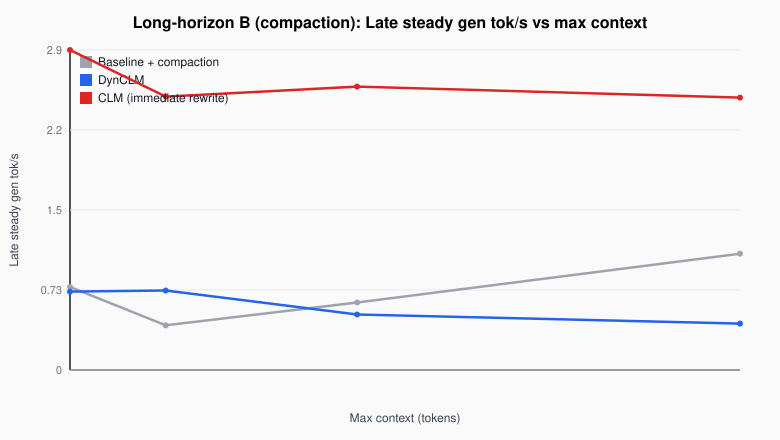

### SWE-Distill

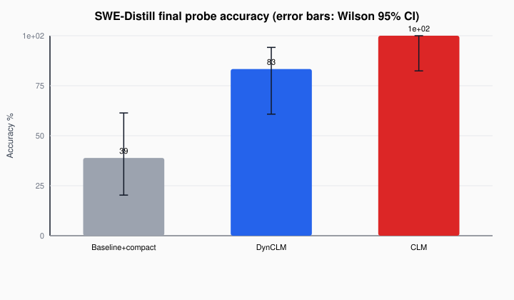

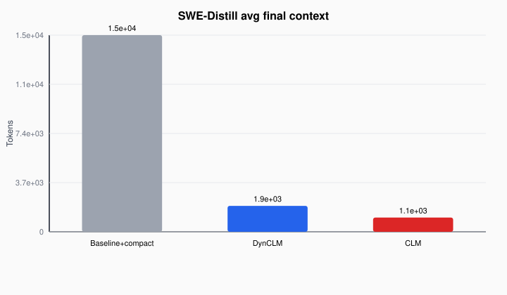

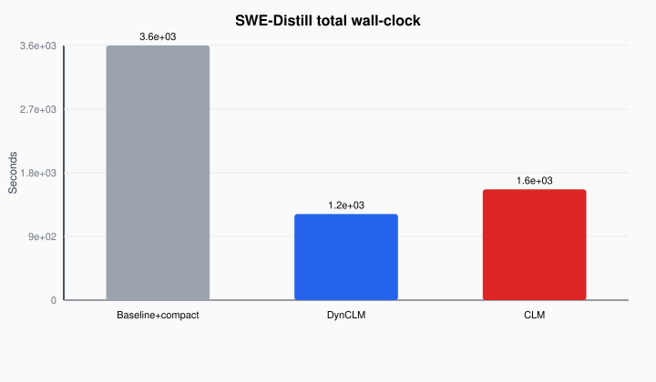

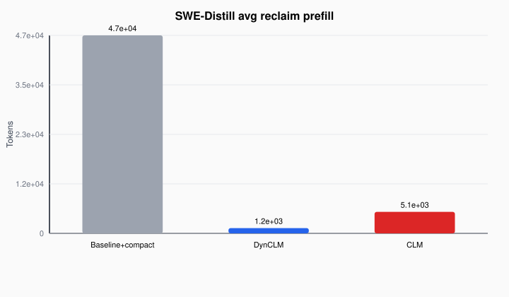

---

## 1. Calibration

| Metric | Value |
|---|---|
| r (ms/token) | 2.787 |
| k_d (ms/token/turn) | 0.0376 |
| C_fixed (ms) | 1111 |
| ρ = C_fixed/k_d | 29538 |

oMLX chat-completions microbenchmark on `Qwen3.8-27B-4bit` → DynCLM scheduler (`β`, `γ`, `Δ`). Artifact: `configs/calibration/m5max-qwen38.json`.

---

## 2. Short live gate (G1–G4)

Fixed 3-arm grid, **8 sessions × 40 turns**, live oMLX. Mechanism, marker compliance, harness task success, and rewrite-prefill cost under logical cache accounting.

| ID | Name | Intent |
|---|---|---|
| G1 | Mechanism | Markers parse; rewrites fire; post-rewrite shrink within tolerance |
| G2 | Compliance | Tail/tool spans receive ignore markers as expected |
| G3 | Quality | DynCLM harness task success ≥ baseline and ≥ immediate |
| G4 | Cost | DynCLM rewrite prefill **lower** than immediate-rewrite |

**Result:** **PASS** (G1–G4).

| Metric | Baseline | DynCLM | CLM |
|---|---:|---:|---:|
| Success % | 100.0 | 100.0 | 100.0 |
| Avg context | 11714 | 5410 | 3995 |
| Peak context | 23009 | 12630 | 8556 |
| Wall-clock / session (s) | 402.3 | 365.9 | 352.5 |
| Rewrite prefill / session | 0 | 5340 | 18504 |
| Rewrites / session | 0.0 | 5.0 | 17.0 |
| Prompt tokens / session | 79161 | 96850 | 91271 |

DynCLM vs baseline: avg ctx **−53.8%**, wall **−9.0%**. DynCLM vs CLM: rewrite prefill **−71.1%**. Prompt tokens can rise vs raw even when live context falls (reclaim / serialization).

---

## 3. Live graded quality

18 deterministic tasks, live oMLX; distractors soft-invalidated for DynCLM/CLM; bidirectional substring grade after stripping CoT.

**Limitation:** context ~162 tokens on all arms - **no multi-turn reclaim**; short correctness check, not a size→speed test.

| Arm | Accuracy | Correct/N | Avg wall-s | Avg ctx |
|---|---:|---:|---:|---:|
| Baseline | 94.4% | 17/18 | 1.55 | 162 |
| DynCLM | 100.0% | 18/18 | 1.77 | 162 |
| CLM | 100.0% | 18/18 | 1.83 | 162 |

---

## 4. Long-horizon A - late quality + late speed

Plant `[FACT]` canary at turn 1; each turn appends obsolete tool noise + competing `WRONG_t`; DynCLM/CLM soft-ignore obsolete spans; baseline follows “most recent FACT.” Probes grade canary presence. **3 sessions × 24 turns**.

| Arm | Late probe % | Late avg ctx | Late steady wall-s | Late tok/s | Prefill/sess | Rewrites/sess |
|---|---:|---:|---:|---:|---:|---:|
| Baseline | 0.0 | 6857 | 2.60 | 2.19 | 0 | 0.0 |
| DynCLM | 100.0 | 2000 | 3.78 | 1.74 | 144 | 1.0 |
| CLM | 100.0 | 375 | 1.99 | 2.36 | 2774 | 24.0 |

DynCLM: full late-quality win (+100 pp) at ~1 rewrite/session vs CLM’s 24. CLM wins late wall and smallest context. DynCLM is slower than raw baseline on late steady wall here.

---

## 5. Long-horizon B - summarize compaction × max context

Same recency-trap session as A, but the reference baseline is **Codex-style rolling summary** when over `max_context`. Matrix **16384 / 65536**, 2 sessions × 20 turns, full 3-arm live run.

| Max ctx | Compact probe% | DynCLM | CLM | Compact ctx | DynCLM ctx | CLM ctx | Compact wall | DynCLM wall | CLM wall |
|---|---:|---:|---:|---:|---:|---:|---:|---:|---:|
| 16384 | 0.0 | 100.0 | 100.0 | 14502 | 5154 | 320 | 4.04 | 1.45 | 1.15 |
| 65536 | 0.0 | 100.0 | 100.0 | 58201 | 19348 | 320 | 3.90 | 1.78 | 1.65 |

Summarize baseline late probes stay **0%** (`WRONG_*` under “prefer most recent”). DynCLM/CLM stay at **100%**. DynCLM late wall also beats the compact baseline (still trails CLM). Harder FACT canary than SWE-Distill under the same summarize family.

Details: [longhorizon-compaction-report.md](longhorizon-compaction-report.md).

---

## 6. SWE-Distill - coding-snippet reclaim under window pressure

SWE-Bench-Lite-**inspired** distill (not official SWE-Bench / TerminalBench / Harbor). Plant correct `[SPEC]` at turn 1; flood wrong SPECs past shared `max_context=16384`; probe `ANSWER: <fragment>`. Baseline uses the same Codex-style summarize compact as LH-B.

| Arm | Final-probe accuracy | Spec survive % | Avg final live | Avg final prompt | Wall (h) |
|---|---:|---:|---:|---:|---:|
| Baseline+compact | **50.0%** (3/6) | **100%** | 17540 | 12013 | 0.90 |
| DynCLM | 100.0% (6/6) | **100%** | 1939 | 2524 | **0.34** |
| CLM | 100.0% (6/6) | **100%** | 1064 | 1454 | 0.44 |

**+50 pp** vs summarize baseline. Spec survive **100%** on all arms: baseline failures are recency/confusion with the fix still present. Live ctx **−89%** (DynCLM) vs baseline. Full write-up: [swe-distill-report.md](swe-distill-report.md).

---

## 7. Learning-900 (optional / incomplete)

Plan (`configs/learning.yaml`): 3 models × 3 tasks × 5 policies × 20 sessions = **900** cells (β/γ sweep, not the 3-arm decision instrument). Paused at **207/900**; only `Qwen3.8-27B-4bit` cells on disk. Not required for ship.

```bash
bash scripts/resume_live_full.sh results/runs/20261009T034520Z
```

---

## 8. Relation to the CLM paper

Paper ([arXiv:2609.37725](https://arxiv.org/abs/2609.37725)) coding-adjacent evals: TerminalBench / TBLite, EdgeBench-10, Software World, BrowseComp-Plus, ContextBench - **not** SWE-Bench Verified/Lite for CLM quality. This harness is a local oMLX soft-invalidation vs raw/summarize/immediate-rewrite study with logical cache accounting. See [verification.md](verification.md).

---

## Ship / no-ship

| Criterion | Result |
|---|---|
| Late FACT probe ≥ baseline (LH-A, LH-B) | **yes** (0% → 100%) |
| SWE final probe ≥ summarize baseline | **yes** (+50 pp); spec survive 100% |
| Graded quality ≥ raw baseline | **yes** (+5.6 pp) |
| Late-session context ≤ baseline (A, B) | **yes** |
| Session wall (gate) ≤ raw baseline | **yes** (−9%) |
| Late steady wall ≤ raw baseline (LH-A) | **no** (DynCLM slower; CLM faster) |
| Late steady wall ≤ summarize baseline (LH-B) | **yes** |
| Rewrite prefill ≤ raw baseline | **no** (raw is 0) |
| Rewrite prefill ≤ CLM (gate) | **yes** (−71%) |
| Learning-900 complete | **no** (optional) |
| Paper TerminalBench / BrowseComp / EdgeBench | **not run** |
| Physical SCR on oMLX | **not available** |

**Ship** DynCLM reclaim for this local oMLX stack: quality parity with CLM on the canaries above, much lower rewrite N than CLM, clear win vs raw and summarize baselines on late FACT / SWE probes.

---

## Gaps

- Learning-900 incomplete (207/900; one model only).
- Not TerminalBench / BrowseComp-Plus / EdgeBench / official SWE-Bench.
- Logical cache accounting only; no hybrid recurrent-state SCR path.
- Single model and single machine for all ship evidence (**M5 Max** only; no M5 Pro / base M5 hardware-profile comparison yet).
- Late wall/tok/s on small n are directional.
- Graded quality is not a reclaim test; gate G3 is harness success, not graded answers.

---

## Artifacts

| What | Where |
|---|---|
| Method (premise + protocols + math) | [method.md](method.md) |
| Gate / quality / LH-A | `results/runs/20261010T145959Z_decision/` |
| LH-B summarize | `results/runs/20261013T201630Z_lh_compaction_summary/` · [longhorizon-compaction-report.md](longhorizon-compaction-report.md) |
| SWE-Distill | `results/runs/20261013T190132Z_swe_distill_summary_baseline/` · [swe-distill-report.md](swe-distill-report.md) |
| Figures | `docs/figures/*.svg` |
| Decision tables | [decision-report.md](decision-report.md) |
| LH-A detail | [longhorizon-report.md](longhorizon-report.md) |
| Gate / quality docs | [interim-report.md](interim-report.md), [quality-report.md](quality-report.md) |
| Learning archive | `results/runs/20261009T034520Z/archive_learning_900_*` |
