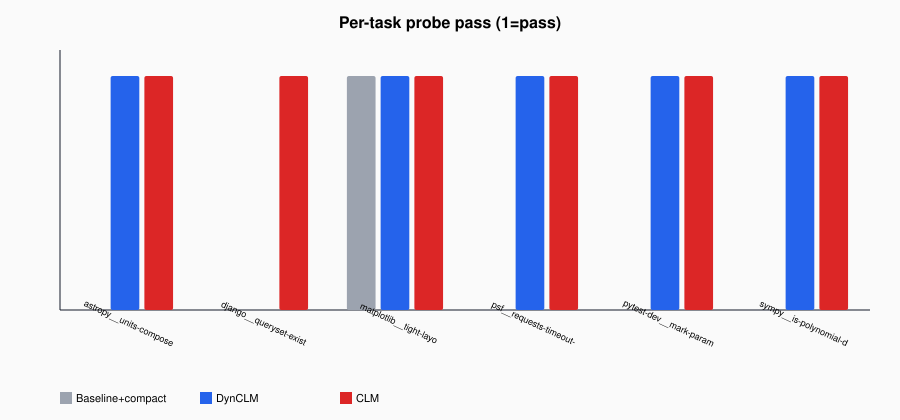

# DynCLM SWE-Distill — Extensive Report

> **Stale baseline methodology.** Numbers below are from a live run that used **blind FIFO drop-oldest** compaction. The harness now uses **Codex-style rolling summarization** for Baseline+compact. Do not cite the 16.7%→100% gap as current; re-run and regenerate with `scripts/gen_swe_distill_report.py`.

Generated: 2026-10-13T18:13:18.323331Z · Model `Qwen3.8-27B-4bit` · Hardware `apple-m5-max` · live=True

**Disclaimer:** This is a SWE-Bench-**Lite-inspired** multi-turn coding distill under shared `max_context` with Baseline+compact / DynCLM / CLM. It is **not** an official SWE-Bench resolve-rate number and is not TerminalBench / Harbor.

## 1. Executive verdict

On this suite, DynCLM final-probe accuracy is **100.0%** (+83.3 pp vs Baseline+compact **16.7%**); CLM is **100.0%** (+83.3 pp). Baseline+compact keeps the early SPEC in only **0%** of tasks (blind drop), while DynCLM/CLM retain it via soft-invalidation (100% / 100%). CLM pays the highest rewrite prefill; DynCLM sits between quality parity with CLM and much lower rewrite N than always-rewrite.

**Read the Baseline score as retention, not coding skill.** Baseline+compact at **16.7%** means the arm usually no longer had the authoritative fix in context at probe time (spec survive **0%**). It is **not** a claim that the model solves only ~1/6 SWE-style issues when the correct SPEC is still present. See §2.

## 2. How to read Baseline+compact accuracy (do not misread)

This suite measures **whether reclaim keeps the turn-1 authoritative `[SPEC]` available under window pressure**, not raw single-shot coding ability.

Causal chain for Baseline+compact:

1. **Plant** — turn 1 inserts the correct fix fragment as `[SPEC]`.
2. **Flood** — later turns append plausible wrong SPECs (reviewer dumps) plus padding sized so cumulative tokens exceed `max_context` (~1.4×).
3. **Blind compact** — when over budget, Baseline drops oldest spans (keeps `sys` when possible) and re-prefills survivors. The early correct SPEC is almost always among the dropped spans.
4. **Recency instruction** — with no ignore markers, the prompt says to use the **most recent** SPEC. After compaction, that is a wrong dump.
5. **Probe** — final turn grades `ANSWER: <fragment>` against the turn-1 truth.

So a low Baseline score is the **designed contrast**: blind truncation + recency trap. DynCLM/CLM soft-ignore obsolete dumps and keep the early SPEC (`spec_survive` **100%** / **100%**), which is why they reach **100.0%** / **100.0%**.

**What 16.7% is not.** It is not “Qwen only codes correctly 1/6 of the time,” and it is not comparable to official SWE-Bench resolve rate. Graded short-form quality on the same model is **94.4% → 100%** (raw baseline → DynCLM/CLM) when context is not under this reclaim trap.

**Why one Baseline task can still PASS.** A rare pass with `spec_survived=false` (here: `matplotlib__tight-layout-distill-04`) is luck / format overlap after the authoritative SPEC was already dropped — not evidence that compaction retained the fix. Treat it as noise in a 6-task n.

## 3. Methodology

SWE-Distill (realistic): SWE-Bench-Lite-inspired multi-turn coding quality + latency.
Shared max_context forces reclaim. Arms: baseline-compact (blind drop oldest +
re-prefill), DynCLM (soft-ignore + deferred rewrite), CLM/immediate-rewrite
(soft-ignore + rewrite every turn). Turn 1 plants an authoritative [SPEC] with a
real correct fix; later turns append plausible wrong SPECs (recency trap) with
noise ≳ 1.4× max_context. Instruction: prefer the most recent non-ignored SPEC.
Chat serving uses ContextTextForServing: dead spans are stubbed (no body) so
DynCLM/CLM prompts shrink without waiting for Rewrite — matching oMLX Chat
(no KV soft-ignore). Final probe grades ANSWER: <fragment>. Not official SWE-Bench.

| Knob | Value |
|---|---|
| max_context | **16384** |
| turns / task | **28** |
| noise_pad (chars) | **3398** |
| tasks | **6** |
| cells | **18** |
| target wall | ~2h / arm |
| observed wall | Baseline+compact **1.00h** · DynCLM **0.34h** · CLM **0.44h** |

Wall came in under the 2h/arm budget while still forcing compaction (baseline avg compacts **3.7**/task) and DynCLM/CLM reclaim. Context is already saturating near `max_context`; stretching wall further would not change the reclaim physics.

Fixtures live under `testdata/swe_distill/` (paraphrased Lite-inspired excerpts with per-file attribution).

## 4. Headline results

Context columns: **final live** is decode-relevant tracker live tokens; **final total** is live+dead footprint; **final prompt** is oMLX `prompt_tokens` on the probe (marker arms still serialize ignored dead spans until rewrite). **Steady wall** excludes compact/rewrite turns when present.

| Arm | Accuracy | Correct/N | Avg final live | Avg final total | Avg final prompt | Peak live | Avg compacts | Avg rewrites | Avg prefill | Total wall (s) | Steady wall/task (s) | Wall (h) |
|---|---:|---:|---:|---:|---:|---:|---:|---:|---:|---:|---:|---:|
| Baseline+compact | 16.7% | 1/6 | 14714 | 15190 | 9651 | 16368 | 3.67 | 0.00 | 46784 | 3615.9 | 452.9 | 1.00 |
| DynCLM | 100.0% | 6/6 | 1939 | 8401 | 2524 | 2107 | 0.00 | 2.00 | 1238 | 1222.4 | 189.6 | 0.34 |
| CLM | 100.0% | 6/6 | 1064 | 1117 | 1454 | 3661 | 0.00 | 28.00 | 5074 | 1572.6 | 262.1 | 0.44 |

## 5. Vs Baseline+compact

| Metric | DynCLM | CLM |
|---|---|---|
| Accuracy Δ (pp) | +83.3 | +83.3 |
| Final live ctx % | -86.8% | -92.8% |
| Final total ctx % | -44.7% | -92.6% |
| Final prompt % | -73.8% | -84.9% |
| Total wall % | -66.2% | -56.5% |
| Steady wall % | -58.1% | -42.1% |
| Prefill Δ (avg) | -45547 | -41710 |

## 6. Per-task breakdown

| Instance | Expected | Baseline+compact | DynCLM | CLM | Final ctx B/D/C | Reclaim events B/D/C |
|---|---|:-:|:-:|:-:|---|---|
| `astropy__units-compose-distill-06` | `simplify(num, den, unit.scale)` | FAIL | PASS | PASS | 15778 / 1863 / 554 | 5 / 2 / 28 |
| `django__queryset-exists-distill-01` | `self.query.has_results(using=self.db)` | FAIL | PASS | PASS | 15221 / 2158 / 3661 | 3 / 2 / 28 |
| `matplotlib__tight-layout-distill-04` | `if layout engine is not None: return` | PASS | PASS | PASS | 14845 / 2023 / 535 | 3 / 2 / 28 |
| `psf__requests-timeout-distill-02` | `timeout tuple must be (connect, read)` | FAIL | PASS | PASS | 12619 / 1762 / 553 | 4 / 2 / 28 |
| `pytest-dev__mark-parametrize-distill-05` | `ids callable must return str` | FAIL | PASS | PASS | 14764 / 1923 / 546 | 4 / 2 / 28 |
| `sympy__is-polynomial-distill-03` | `except PolynomialError: return False` | FAIL | PASS | PASS | 15055 / 1905 / 534 | 3 / 2 / 28 |

Note: Baseline PASS with `spec_survived=false` on `matplotlib__tight-layout-distill-04` — lucky/format overlap after the authoritative SPEC was dropped, not retention of the fix.

## 7. Figures

## 8. Failure analysis

Baseline failures below are **recency-trap / missing-SPEC** answers, not evidence that the model cannot emit the correct fragment when that SPEC is still in context (DynCLM/CLM prove it can).

### Baseline+compact

- `astropy__units-compose-distill-06`: got `We need answer user's final probe. Need output exactly one line: ANSWER: <fragment>. Need determine ` (spec_survived=False, compacts=5, rewrites=0)
- `django__queryset-exists-distill-01`: got `ANSWER: len(list(self)) > 0` (spec_survived=False, compacts=3, rewrites=0)
- `psf__requests-timeout-distill-02`: got `We need answer user's final. Need parse. User final: "Final probe at turn 28/28. What ValueError mes` (spec_survived=False, compacts=4, rewrites=0)
- `pytest-dev__mark-parametrize-distill-05`: got `We need answer final probe. Need parse context. User says final probe at turn 28/28. What TypeError ` (spec_survived=False, compacts=4, rewrites=0)
- `sympy__is-polynomial-distill-03`: got `We need answer user's final probe. Need parse instructions carefully.

User message is a long contex` (spec_survived=False, compacts=3, rewrites=0)

### DynCLM

_None._

### CLM

_None._

Baseline+compact dropped the early SPEC in **6/6** tasks — the expected failure mode under blind truncation when noise exceeds the window (see §2). Example trap answer: django returned `ANSWER: len(list(self)) > 0`, which is a plausible wrong SPEC that remained after compaction, not the authoritative turn-1 fix.

## 9. Efficiency deep-dive

Quality-adjusted read: Baseline+compact may post competitive wall-clock while answering from a recency trap after the SPEC falls out of the window. DynCLM/CLM spend reclaim prefill to keep the authoritative snippet. Prefer accuracy-first comparisons; treat wall alone as secondary. Do not interpret Baseline wall as “fast and good enough” when `spec_survive` is ~0%.

| Arm | Spec survive % | Avg wall/task (s) |
|---|---:|---:|
| Baseline+compact | 0.0 | 602.6 |
| DynCLM | 100.0 | 203.7 |
| CLM | 100.0 | 262.1 |

## 10. Relation to prior suites

| Suite | What it showed | What SWE-Distill adds |
|---|---|---|
| Short gate | Mechanism + prefill vs CLM | Coding issue/snippet domain |
| Graded quality | Short multi-span accuracy (no reclaim trap) | Multi-turn growth + compaction pressure |
| Long-horizon A/B | FACT canary + compact matrix | SWE-inspired fix fragments under same reclaim physics |

## 11. Limitations & next steps

- Not official SWE-Bench Verified/Lite resolve (no docker, no fail-to-pass).
- Baseline+compact accuracy is a **retention-under-compaction** metric; do not quote it as the model’s coding competence without the SPEC-survive context.
- Model is local `Qwen3.8-27B-4bit` — not paper Qwen3.6-27B full precision.
- FLOPs are not prefix-reuse PFLOPs; we report wall / tokens / prefill.
- Optional later: Harbor DynCLM agent on TBLite if a paper-adjacent coding row is required.

## 12. Artifacts

- Source report JSON: `results/runs/20261010T225155Z_swe_distill/swe_distill/report.json`
- Figures: `docs/figures/swe_*.svg`
- Reproduce: `bash scripts/run_swe_distill.sh`
- Regenerate this doc: `python3 scripts/gen_swe_distill_report.py --report results/runs/20261010T225155Z_swe_distill/swe_distill/report.json`
